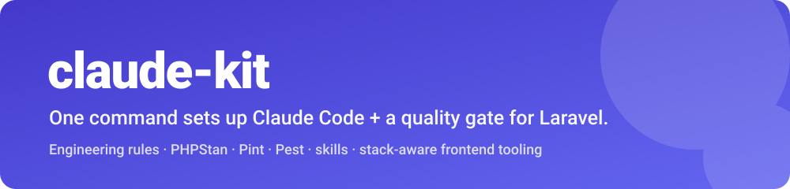

<p align="center">
  
</p>

<h1 align="center">claude-kit</h1>

<p align="center">
  <strong>Set up <a href="https://claude.com/claude-code">Claude Code</a> — and any AI coding agent — on a Laravel project in one command.</strong><br>
  Engineering rules, a quality gate (PHPStan · Pint · Pest), skills, feature-doc scaffolding, and stack-aware frontend tooling.
</p>

<p align="center">
  <a href="https://packagist.org/packages/mohamed-ashraf-elsaed/claude-kit"></a>
  <a href="https://github.com/mohamed-ashraf-elsaed/claude-kit/actions/workflows/tests.yml"></a>
  <a href="https://github.com/mohamed-ashraf-elsaed/claude-kit/actions/workflows/lint.yml"></a>
  <a href="https://packagist.org/packages/mohamed-ashraf-elsaed/claude-kit"></a>
  <a href="https://packagist.org/packages/mohamed-ashraf-elsaed/claude-kit"></a>
  <a href="LICENSE"></a>
</p>

---

`claude-kit` packages a battle-tested setup so every Laravel project — and every
developer — gets the same guardrails instead of hand-copying config between
repos: a Stop-hook + pre-commit **quality gate**, reusable Claude Code **skills**,
PHPStan level 7 + strict-rules, Pint, Pest with an 80% coverage gate, an
architecture test suite, feature-doc scaffolding, and **stack-aware frontend
tooling** (Vue, React, Blade, or none).

### Who it's for

- Teams putting **Claude Code**, **Cursor**, or **GitHub Copilot** to work on a **Laravel** codebase and wanting consistent, enforced conventions.
- Anyone who wants **one command** for PHPStan + Pint + Pest + git hooks instead of wiring them by hand.
- Projects that need **AI coding guardrails** an agent can't skip — the same gate runs at commit time, at the end of every Claude turn, and in CI.

## Table of contents

- [Requirements](#requirements)
- [Installation](#installation)
- [What it installs](#what-it-installs)
- [Choosing what to install](#choosing-what-to-install)
- [The hybrid update model](#the-hybrid-update-model)
- [The quality gate](#the-quality-gate)
- [Documentation](#documentation)
- [Contributing](#contributing)
- [Security](#security)
- [License](#license)

## Requirements

- PHP **8.2+**
- Laravel **11, 12, or 13**
- [Claude Code](https://claude.com/claude-code) (to use the rules, hooks, and skills)
- A coverage driver (`pcov` or Xdebug) only if you ask the gate to enforce coverage

## Installation

```bash
composer require --dev mohamed-ashraf-elsaed/claude-kit
php artisan claude-kit:install
```

claude-kit itself depends only on Laravel — it will not pull Pint, PHPStan, or a
test runner into your project, and it will not move a version you already have.
The installer detects your frontend stack (Inertia + Vue, Inertia + React,
Livewire, Blade, or API-only), asks which parts to scaffold, works out the exact
tooling your answers need, and offers to install it:

```
The selected tooling is not installed yet: laravel/pint, larastan/larastan, pestphp/pest
Run `composer require --dev laravel/pint larastan/larastan pestphp/pest` now? (yes/no) [yes]
```

Anything already in your project is left out of that list. Decline it, or run
with `--no-interaction`, and the command is printed for you to run yourself.

> [!NOTE]
> **If that command fails on Pest, it is an upstream conflict, not claude-kit.**
> Current Pest releases conflict with `phpunit/phpunit` newer than 12.5.30, and
> the Laravel 13 skeleton pins a newer PHPUnit — so `composer require --dev
> pestphp/pest` cannot resolve on a fresh Laravel 13 app even with claude-kit
> uninstalled. Re-running the same command with `-W` resolves it by letting
> composer downgrade PHPUnit to 12.5.30. claude-kit never adds `-W` for you;
> accepting that downgrade is your decision.

Then:

```bash
composer install   # wires the git pre-commit hook
composer lint      # once, to normalize Laravel's shipped files
npm install        # only if a frontend stack was set up
```

Not published to Packagist yet? Install straight from GitHub by adding this to
your `composer.json` and running `composer require --dev mohamed-ashraf-elsaed/claude-kit:dev-main`:

```json
{
    "repositories": [
        { "type": "vcs", "url": "https://github.com/mohamed-ashraf-elsaed/claude-kit" }
    ]
}
```

## What it installs

| Part | What lands in your project |
| --- | --- |
| **.claude core** | `.claude/settings.json` (hook wiring + permission allowlist, **deep-merged** into any existing file), the reusable skills for your stack, and `.mcp.json` (Laravel Boost). |
| **CLAUDE.md** | Short and specific: project identity, the quality gate, the feature-doc rule, and an index of the installed rules — inside `claude-kit:begin`/`end` markers, so re-running refreshes it without touching your own additions. |
| **Rules** | `.claude/rules/` — one file per selected architecture layer, a clean-code rule (strict / balanced / relaxed), a stack-specific frontend rule, and the always-on anti-overengineering + anti-assumption rules. Path-scoped where it makes sense, so they load only when relevant. |
| **Agents** | Read-only `design-reviewer` (output vs the stated design) and `docs-reviewer` (output vs supplied docs). |
| **Workflow skills** | `/commit`, `/deploy` (both you-only), `/dead-code`, `/codemap`. |
| **Quality gate** | `phpstan.neon` (your level, Larastan and strict-rules toggles), `pint.json`, a **generated** `tests/Arch/ArchTest.php` matching your layers — plus a `tests/Arch` testsuite added to your `phpunit.xml` so it actually runs — `.githooks/pre-commit`, an edit-time PHPStan hook, and merged composer scripts. |
| **Frontend** | Stack-matching `eslint.config.js` / `.prettierrc` / `tsconfig.json`, plus merged `package.json` scripts and devDependencies. Skipped for API-only projects. |
| **Docs** | `features/_TEMPLATE/` + `features/README.md`, `.editorconfig`, `.gitattributes`. |
| **CI** | Generic GitHub Actions `tests.yml` and `lint.yml`. |

Nothing is clobbered. An identical file is left alone, a file you have edited is
asked about (keep / replace / show diff), `settings.json` and `CLAUDE.md` are
merged rather than replaced, and `composer.json` / `package.json` keep your
entries. Every convention claude-kit writes for you is marked `<!-- DRAFT -->`
so you can review it before adopting it.

## Choosing what to install

`claude-kit:install` is a **fully interactive configurator** — it asks what you
want rather than assuming:

- **Code style:** Pint on/off
- **Static analysis:** PHPStan on/off → level (0–9) → Larastan on/off →
  strict-rules on/off → analyse each edited file? → block or warn only
- **Tests:** on/off → runner (Pest / PHPUnit) → coverage minimum → architecture tests
- **Architecture:** any of Services · Repositories · Data Objects · Value
  Objects · Actions · Contracts. A layer you decline gets no rule, no `arch()`
  block, and no mention in CLAUDE.md
- **Clean code:** strict / balanced / relaxed — three concrete rule variants
- **Hooks:** Stop hook (which checks + how many consecutive clean runs), git
  pre-commit hook, feature-doc requirement
- **Reviewers:** `design-reviewer`, `docs-reviewer`
- **Workflow skills:** `/commit` (your convention, verbatim), `/deploy` (your
  command, or a marked TODO — never a guess), `/dead-code`, `/codemap`
- **Behavioural rules:** anti-overengineering, anti-assumption; plus the
  git-worktree workflow rule and a concise output style
- **Skills:** which bundled skills to install — plus optional search & install of
  more via [skills.sh](https://www.skills.sh) (`npx skills find` / `add`)
- **Extras:** CLAUDE.md + rules, feature-doc templates, `.editorconfig`, MCP, CI

Your answers are recorded in `.claude/claude-kit.json`, which the quality gate
and `claude-kit:update` read.

```bash
php artisan claude-kit:install                      # interactive (recommended)
php artisan claude-kit:install --stack=inertia-react # preselect the stack
php artisan claude-kit:install --no-interaction      # accept sensible defaults
php artisan claude-kit:install --force               # replace existing files

php artisan claude-kit:update                        # refresh what you installed
```

- **Stacks:** `inertia-vue`, `inertia-react`, `livewire`, `blade`, `none`

## The hybrid update model

- **Machinery** — `quality-checks.sh` and the Stop hook — lives in
  `vendor/mohamed-ashraf-elsaed/claude-kit/runtime/` and is *referenced*, so
  `composer update` propagates fixes to every project automatically.
- **Content you own** — `CLAUDE.md`, the rules, the skills, the agents, the
  feature templates, the linter configs, and the generated `phpstan.neon` — is
  written into your repo so you can customise it freely.
- `php artisan claude-kit:update` refreshes that copied content: a file you never
  touched is updated silently, a file you edited is never replaced without asking.

## The quality gate

`vendor/mohamed-ashraf-elsaed/claude-kit/runtime/quality-checks.sh` is the single
source of truth. It runs Pint, PHPStan at your level, and your test runner with
your coverage floor, then the frontend checks your `package.json` actually
defines. The same script backs the git pre-commit hook, Claude's Stop hook, and
CI — so the gate is identical everywhere.

- The Stop hook requires **N consecutive clean runs** (default 2) before Claude
  may finish a turn, and can be limited to a subset of the checks.
- Coverage needs the `pcov` or Xdebug extension; without it, the gate warns
  instead of blocking on coverage only.
- Disable the feature-doc requirement with `CLAUDE_KIT_FEATURE_DOCS=0`.

## Documentation

Full guides live in the [wiki](https://github.com/mohamed-ashraf-elsaed/claude-kit/wiki)
and the [`docs/`](docs/) directory:

- [Installation](docs/Installation.md)
- [Usage](docs/Usage.md)
- [Configuration](docs/Configuration.md)
- [Frontend stacks](docs/Frontend-Stacks.md)
- [Quality gate](docs/Quality-Gate.md)
- [Skills](docs/Skills.md)
- [Architecture](docs/Architecture.md)
- [Publishing to Packagist](docs/Publishing.md)
- [Upgrading](docs/Upgrading.md)
- [FAQ](docs/FAQ.md)

## Contributing

Contributions are welcome! Please read [CONTRIBUTING.md](CONTRIBUTING.md) and the
[Code of Conduct](CODE_OF_CONDUCT.md). Releases follow [SemVer](https://semver.org);
see [RELEASING.md](RELEASING.md).

## Security

Please report vulnerabilities privately — see [SECURITY.md](SECURITY.md).

## License

The MIT License. See [LICENSE](LICENSE).
