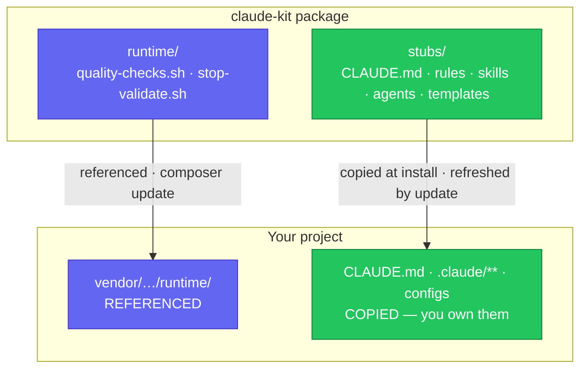
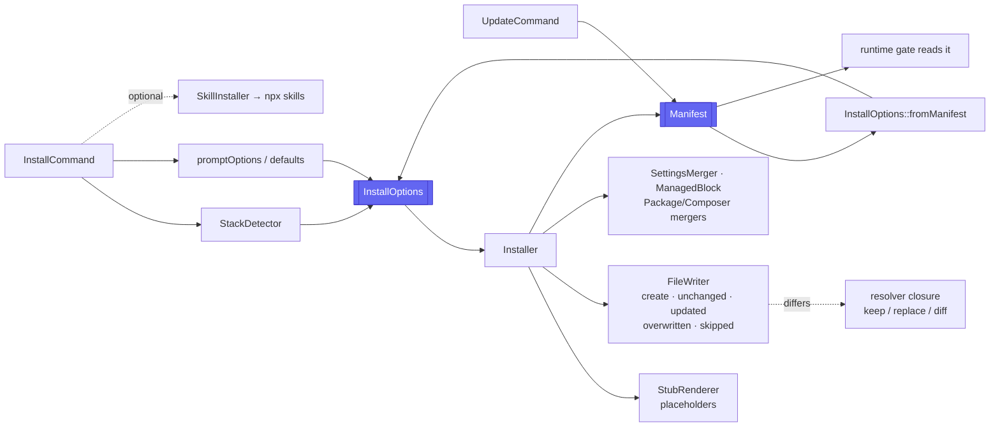

# 🏗️ Architecture

claude-kit is a small, focused Composer package. This page explains how it is built so contributors change the right thing in the right place.

## The hybrid model

Everything the package ships falls into one of two buckets:



- **`runtime/` is referenced.** Host projects call it in place at `vendor/…/runtime/`, so a `composer update` propagates fixes to every consumer. Treat it as a public API — the host's Stop hook and generated `phpstan.neon` point at these paths.
- **`stubs/` is published.** Copied into the host; consumers own their copy. `claude-kit:update` re-publishes them, using the per-file hashes in the manifest to tell an untouched file from an edited one.
- **The one exception**: `.claude/hooks/phpstan-check.sh` is a *published* hook, because it is rendered per project (its mode comes from your answer).

> The rule: **machinery** goes in `runtime/`, **content/opinion** goes in `stubs/`.

## How a run flows



The command layer owns every prompt. `Installer` and `FileWriter` never prompt — they receive a resolver closure and call it when a file exists and differs, which is what keeps the scaffolder testable against a temp directory.

## Components

```
src/
  ClaudeKitServiceProvider.php   Registers both commands (package discovery)
  Commands/
    InstallCommand.php           Thin: resolve stack + prompt → InstallOptions → Installer
    UpdateCommand.php            Thin: manifest → InstallOptions → Installer (hash-aware)
    Concerns/
      PromptsForFileConflicts.php  The shared keep/replace/diff prompt
  Support/
    FrontendStack.php            Enum — the ONE place per-stack differences live
    TestTool.php                 Enum — Pest | PHPUnit
    CleanCodePreset.php          Enum — strict | balanced | relaxed → rule stub
    InstallOptions.php           Readonly DTO — every choice + defaults() + fromManifest()
    StackDetector.php            composer.json + package.json → FrontendStack
    Installer.php                Pure filesystem scaffolder (no shell-outs)
    FileWriter.php               One place decides what happens to an existing file; line diff
    StubRenderer.php             Reads a stub, substitutes {{PLACEHOLDER}}
    Manifest.php                 .claude/claude-kit.json (+ legacy fallback) and file hashes
    SettingsMerger.php           Deep, non-destructive .claude/settings.json merge
    ManagedBlock.php             begin/end delimited region inside CLAUDE.md
    PhpunitXmlPatcher.php        Adds a tests/Arch testsuite to the host phpunit.xml (DOM)
    SkillInstaller.php           Wraps npx skills find/add (skills.sh)
    PackageJsonMerger.php        Idempotent, non-destructive package.json merge
    ComposerJsonMerger.php       Idempotent, non-destructive composer.json merge
```

- **`InstallCommand` / `UpdateCommand`** do no file work — they resolve inputs and delegate. Both mix in the same conflict prompt.
- **`Installer`** is pure I/O: generates `.claude/settings.json` (merged), `phpstan.neon`, `tests/Arch/ArchTest.php` (composed from per-layer fragments), the CLAUDE.md managed block, and the manifest; publishes the selected rules, agents, skills, output style, and hook; returns a per-file report.
- **`FrontendStack`** centralises per-stack skills, npm scripts, devDependencies, stub directory, frontend rule stub, and CLAUDE.md prose. Add a stack here + a `stubs/frontend/<dir>/` + a `stubs/claude/rules/frontend-<stack>.md`.
- **Per-layer differences** (directory, label, rule, arch fragment) live in `Installer::LAYERS` and `stubs/tests/Arch/layers/`.

## Two write paths

| Path | Used for | Behaviour on an existing file |
| --- | --- | --- |
| `FileWriter::put()` | rules, skills, agents, configs, hooks, templates — wholesale copies | identical → `unchanged`; matches its published hash → `updated`; otherwise ask (or skip) |
| `FileWriter::putMerged()` | `.claude/settings.json`, `CLAUDE.md`, `phpunit.xml` | never asks: the content already incorporates what was there, so nothing can be lost |

## Testing

- **Unit** tests exercise `StackDetector`, the mergers, `SettingsMerger`, `ManagedBlock`, `FileWriter` (including the diff), `Manifest`, `StubRenderer`, the enums, `InstallOptions`, and `Installer` against temp directories (`temp_project()` / `stubs_path()` helpers in `tests/Pest.php`).
- **Feature** tests drive `claude-kit:install` and `claude-kit:update` through Testbench — including a full interactive walkthrough and the keep/replace decisions — and fake `npx` via `Process::fake()`.
- The shell scripts are verified by hand against sample hook payloads (stdin JSON for the PostToolUse hook, manifest fixtures for the Stop hook loop).
- Coverage is enforced at **80%+** in CI.

## Dogfooding

The repo runs its own gate (`bin/quality-checks.sh`) via the committed `.githooks/pre-commit`, including a **changelog rule** — the same philosophy it ships. (A local Claude Stop hook may live in a gitignored `.claude/`.)

---
<sub>[← Skills](Skills) · 🏠 [Home](Home) · [Publishing →](Publishing)</sub>
