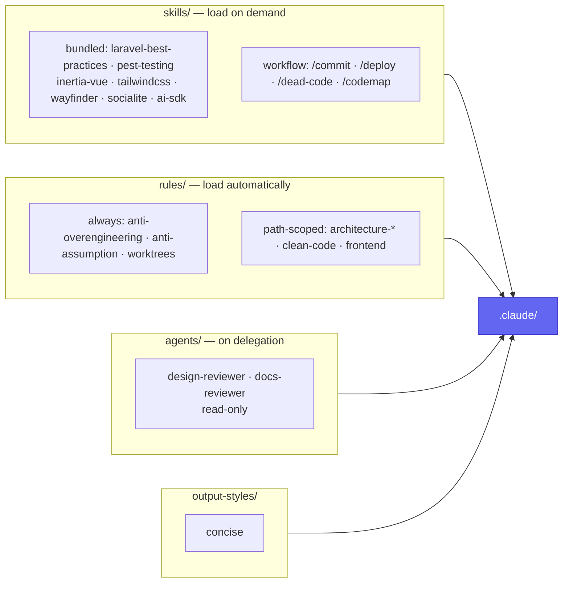

# 🧠 Skills, agents & rules

claude-kit publishes four kinds of Claude Code extension into `.claude/`. Each loads at a different moment, which is why they are separate things.



## Bundled skills

Claude activates these based on the work at hand, or you invoke one with `/<skill-name>`.

**Installed for every stack:**

- **laravel-best-practices** — Laravel patterns: queries, security, validation, caching, queues, migrations, and more (one rule file per topic under `rules/`).
- **pest-testing** — writing and fixing Pest tests (feature/unit/browser, datasets, mocking, architecture tests).

**Installed per stack** (see **[Frontend stacks](Frontend-Stacks)**): **inertia-vue-development**, **wayfinder-development**, **tailwindcss-development**.

**Available to select:** **socialite-development**, **ai-sdk-development**.

## Workflow skills

Authored by claude-kit and installed by choice:

| Skill | What it does | Invocation |
| --- | --- | --- |
| `/commit` | Reviews the real diff, refuses to commit secrets or debug leftovers, stages deliberately, and writes a message in your convention. Never `--no-verify`. | **You only** (`disable-model-invocation: true`) |
| `/deploy` | Runs your deploy command after the gate passes, collecting the per-feature `DEPLOY.md` steps first, then verifies and reports. | **You only** (`disable-model-invocation: true`) |
| `/dead-code` | Detect → *prove unreachable* → remove → verify. Includes the dynamic-reference checklist that makes deletion safe. | You or Claude |
| `/codemap` | Creates or refreshes `CODEMAP.md` from what is actually in the repo. | You or Claude |

`/commit` and `/deploy` are deliberately **not** model-invocable: Claude should never decide on its own to commit or deploy.

> The commit convention is whatever you told the installer — Conventional Commits, or your own wording embedded verbatim. If you left the deploy command blank, `/deploy` ships a marked **TODO** rather than a guess.

## Rules

Rules are conventions that load **without being invoked** — either every session, or when Claude touches matching files.

| Rule | Scope |
| --- | --- |
| `architecture-<layer>.md` | `app/**/*.php` — one per selected layer |
| `clean-code.md` | `**/*.php` — your strict / balanced / relaxed preset |
| `frontend.md` | your stack's files (`resources/js/**`, `resources/views/**`, `app/Livewire/**`) |
| `anti-overengineering.md`, `anti-assumption.md` | always loaded |
| `worktrees.md` | always loaded |

> [!IMPORTANT]
> Every convention claude-kit authors ships marked `<!-- DRAFT -->`. They are a strong starting point, not your team's standard — read them, correct them, then delete the markers.

## Review agents

Both are **read-only** (`disallowedTools: Write, Edit`) and report rather than fix:

- **design-reviewer** — give it the plan/spec and the implementation; it reports where the code deviates, plus anything built that was never asked for.
- **docs-reviewer** — give it the reference docs (paths or URLs) and the code; it checks names, versions, required fields, and error handling against what the document actually says.

## Finding more skills (skills.sh)

During install, after picking the bundled skills, you can search the [skills.sh](https://www.skills.sh) registry and install without leaving the prompt:

```bash
npx skills find <query>      # search the registry
npx skills add <package>     # install into .claude/skills
```

> [!NOTE]
> This requires `npx` (Node.js). If it's not available, the step is skipped with a notice — the bundled skills still install.

## Customising & refreshing

Everything under `.claude/` is plain Markdown you own. Because it is *copied* rather than referenced, `composer update` does not change it. Pull the latest shipped versions with:

```bash
php artisan claude-kit:update
```

Anything you have edited is never replaced without asking first.

---
<sub>[← Quality gate](Quality-Gate) · 🏠 [Home](Home) · [Architecture →](Architecture)</sub>
