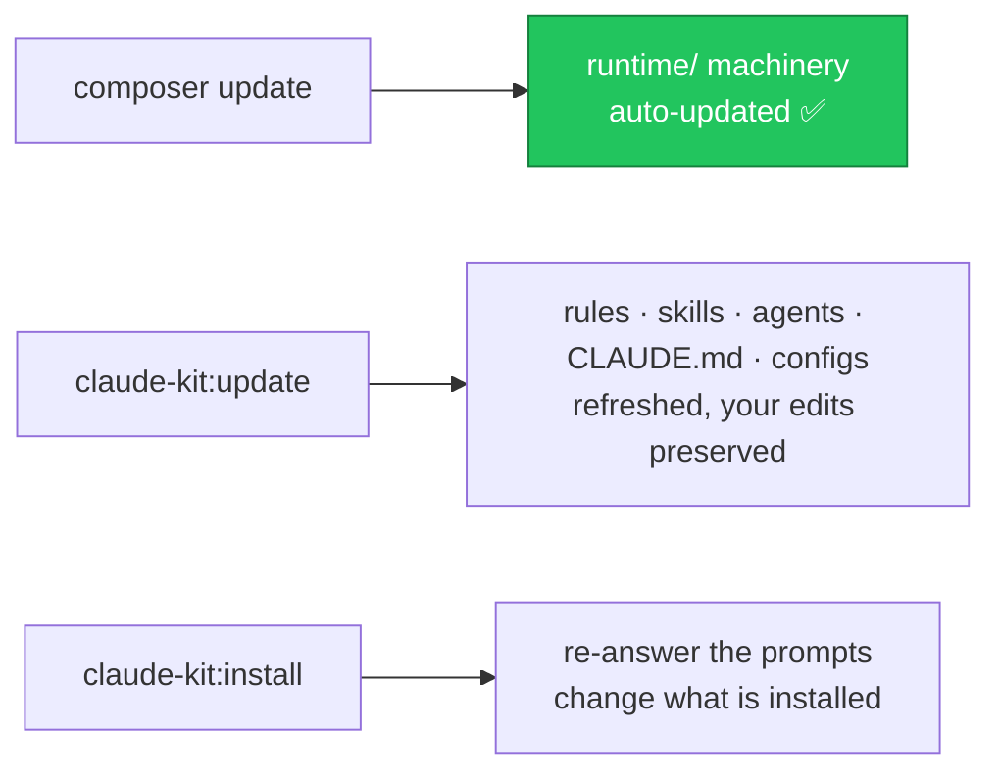

# ⬆️ Upgrading

## Update the package

```bash
composer update mohamed-ashraf-elsaed/claude-kit
```

This immediately updates the **referenced machinery** under `vendor/…/runtime/` (the quality gate and Stop hook) — no other action needed.

## Refresh the copied content

The **published** files (rules, skills, agents, `CLAUDE.md`, linter configs, templates) were copied into your repo, so `composer update` does not touch them. Refresh them with:

```bash
php artisan claude-kit:update
```

This re-publishes the stubs for the options you chose at install time — it asks nothing about *what* to install. For each file:

| Your copy | What happens |
| --- | --- |
| identical to the new version | nothing, reported `unchanged` |
| untouched since claude-kit wrote it (hash still matches the manifest) | refreshed silently, reported `updated` |
| edited by you | you are asked: keep / replace / show diff (plus keep-all and replace-all) |

> [!TIP]
> `claude-kit:update --force` replaces everything, including your edits. `--no-interaction` keeps every edited file untouched, which makes it safe in CI.

To change *which* options are installed, run `php artisan claude-kit:install` again.

## What updates how



## Reading the changelog

Every release documents what changed in [CHANGELOG.md](https://github.com/mohamed-ashraf-elsaed/claude-kit/blob/main/CHANGELOG.md). While the package is `0.x`, minor versions may include breaking changes — check the changelog before updating.

## Versioning

The package follows [SemVer](https://semver.org). Pin a constraint that matches your tolerance for change, e.g. `"^0.2"` (allows `0.2.*` and up within `0.x`) or a stricter `"0.2.*"`.

---
<sub>[← Publishing](Publishing) · 🏠 [Home](Home) · [FAQ →](FAQ)</sub>
