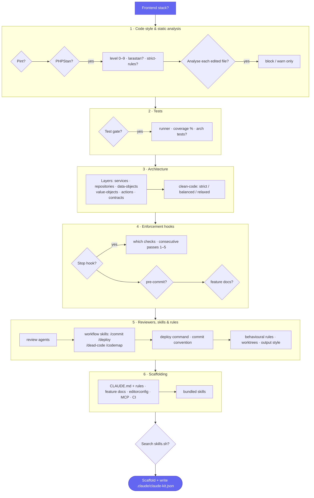

# ⚙️ Usage

`claude-kit:install` is a **fully interactive configurator** — it asks what you want instead of assuming.

## The commands

```bash
php artisan claude-kit:install [--stack=] [--force] [--no-interaction]
php artisan claude-kit:update  [--force]
```

| Option | Description |
| --- | --- |
| `--stack=` | `inertia-vue`, `inertia-react`, `livewire`, `blade`, or `none`. Auto-detected when omitted. |
| `--force` | Replace files that already exist without asking. |
| `--no-interaction` | Skip the prompts, accept the defaults, and keep every existing file (great for CI). |

## The interactive flow



### 1 · Code style & static analysis

| Prompt | Options | Default |
| --- | --- | --- |
| Use Laravel Pint for code style? | yes / no | yes |
| Use PHPStan for static analysis? | yes / no | yes |
| Which PHPStan level? | 0–9 | 7 |
| Add Larastan (Laravel-aware analysis)? | yes / no | yes |
| Enable phpstan-strict-rules? | yes / no | yes |
| Analyse every PHP file Claude edits, as it edits it? | yes / no | yes |
| When that check fails, what should happen? | block / warn only | block |

The level is asked **once** and drives both `phpstan.neon` and the hook.

### 2 · Tests

Test gate on/off → runner (**Pest** / PHPUnit) → minimum coverage % (**blank by default** — nothing is enforced unless you type a number) → architecture test suite (**Pest only**: the arch prompt is not offered for PHPUnit, and a manifest that asks for both is ignored).

When the arch suite is selected, a `tests/Arch` testsuite is added to your `phpunit.xml` — without it Laravel would never discover the file.

### 3 · Architecture

Pick any of **Services · Repositories · Data Objects · Value Objects · Actions · Contracts**. Each one you pick publishes `.claude/rules/architecture-<layer>.md` and adds its `arch()` block to the generated `tests/Arch/ArchTest.php`. Each one you skip gets **no rule, no arch block, and no mention in CLAUDE.md**.

Then choose the clean-code strictness:

| Preset | Method | Class | Params | Nesting | `else` |
| --- | --- | --- | --- | --- | --- |
| **strict** | 20 lines | 150 lines | 3 | 2 | not used |
| **balanced** *(default)* | 40 lines | 300 lines | 5 | 3 | for a genuine two-way branch |
| **relaxed** | no limit | no limit | no limit | no limit | allowed |

### 4 · Enforcement hooks

- **Stop hook** — validates the gate when Claude finishes a turn. Choose which checks run (Pint / PHPStan / tests) and how many **consecutive clean runs** are required (1–5, default 2). Any failure blocks the turn and feeds the errors back.
- **git pre-commit hook** — the same gate at commit time.
- **Feature-doc requirement** — part of the Stop hook.

### 5 · Reviewers, skills & rules

- **Review agents** (read-only): `design-reviewer`, `docs-reviewer`.
- **Workflow skills**: `/commit`, `/deploy`, `/dead-code`, `/codemap`.
- **Deploy command** — used verbatim in `/deploy`. Leave it blank and the skill ships a marked TODO; claude-kit never invents a deploy command.
- **Commit convention** — Conventional Commits, or describe your own and it is embedded **exactly as typed**.
- **Behavioural rules** (always loaded): anti-overengineering, anti-assumption.
- **Worktree workflow rule** and the **concise output style** (which is also selected in `settings.json`).

### 6 · Scaffolding

CLAUDE.md + `.claude/rules/` · feature-doc templates · `.editorconfig` + `.gitattributes` · Laravel Boost MCP · GitHub Actions — then which bundled skills to install, and optionally a **[skills.sh](https://www.skills.sh)** search.

Your answers are written to `.claude/claude-kit.json`, which the gate and `claude-kit:update` read. See **[Configuration](Configuration)**.

## Defaults (`--no-interaction`)

> Pint on · PHPStan level 7 + Larastan + strict-rules + the edit-time hook in `block` mode · Pest with architecture tests and **no** coverage threshold · all six layers · balanced clean-code · all three enforcement hooks with 2 consecutive passes · both review agents · all four workflow skills (deploy command left as a TODO) · both behavioural rules · worktrees rule · concise output style · the stack's default skills · all extras.

## Re-running & idempotency

Re-running is safe:

- A file that is **byte-identical** is reported `unchanged` and never touched.
- A file that **differs** is asked about — keep / replace / show diff, plus keep-all and replace-all. `--force` replaces everything; `--no-interaction` keeps everything.
- `.claude/settings.json` is **deep-merged**: your keys are never removed and, on a conflict, your value wins.
- `CLAUDE.md` gains or refreshes a **managed block**; anything you wrote outside the markers is untouched.
- `composer.json` and `package.json` are **merged** — your entries win.

## Updating later

```bash
composer update mohamed-ashraf-elsaed/claude-kit   # machinery, automatically
php artisan claude-kit:update                      # refresh the copied content
```

`claude-kit:update` re-publishes exactly what you selected at install time. A file you never edited (its hash still matches the manifest) is refreshed silently; a file you edited is never replaced without asking. See **[Upgrading](Upgrading)**.

---
<sub>[← Installation](Installation) · 🏠 [Home](Home) · [Configuration →](Configuration)</sub>
